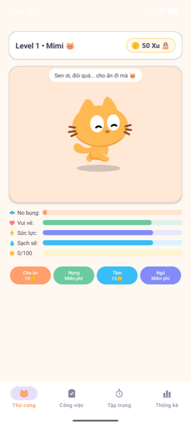
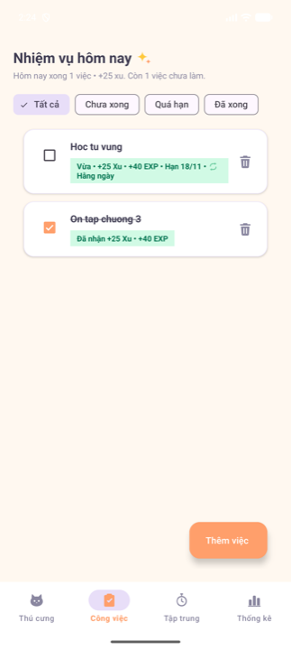
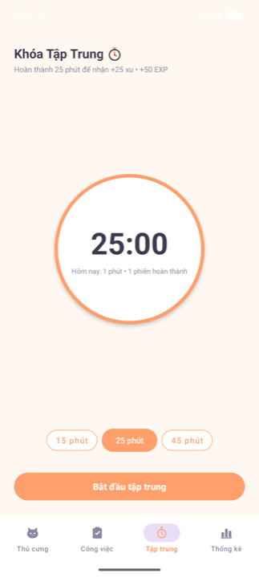
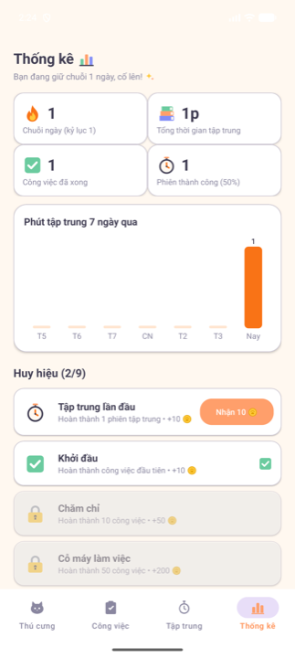
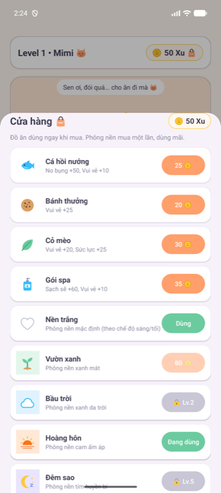
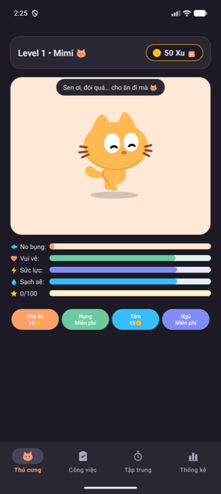

# FocusPet 🐱

Ứng dụng Android giúp bạn **làm việc và tập trung** bằng cách nuôi một bé mèo ảo.
Hoàn thành công việc và giữ tập trung (không dùng điện thoại) để kiếm xu và EXP, rồi dùng xu chăm sóc mèo.
Bỏ bê thì mèo đói, buồn rồi giận dỗi.

Đồ án môn Lập trình di động.

| Thú cưng | Công việc | Tập trung |
|:---:|:---:|:---:|
|  |  |  |
| **Thống kê** | **Cửa hàng** | **Chế độ tối** |
|  |  |  |

## Tính năng

**🐱 Thú cưng**
- 4 chỉ số: No bụng, Vui vẻ, Sức lực, Sạch sẽ. Các chỉ số **tự giảm theo thời gian thật**, kể cả khi đóng app.
- 4 hành động: Cho ăn, Nựng, Tắm, Ngủ. Mỗi hành động có giá xu và thời gian hồi riêng.
- Lên cấp bằng EXP. Mỗi lần lên cấp được thưởng xu, và mèo nảy lên ăn mừng.
- Animation (Lottie) và lời thoại đổi theo tâm trạng của mèo.
- Hiệu ứng "+xu", "+EXP" bay lên mỗi khi nhận hoặc tiêu xu.
- Nhấn giữ dòng "Level…" để đổi tên mèo.

**✅ Công việc**
- Thêm và sửa việc, có độ khó (Dễ / Vừa / Khó) và hạn chót.
- **Việc lặp lại** hằng ngày hoặc hằng tuần: làm xong thì app tự tạo việc cho lần kế tiếp.
- Tick để nhận thưởng. **Bỏ tick thì bị trừ lại đúng phần đã nhận**, kể cả tụt cấp nếu cần.
- Lọc: Tất cả / Chưa xong / Quá hạn / Đã xong. Vuốt để xóa, có nút Hoàn tác.

**⏱️ Tập trung**
- Đồng hồ đếm ngược 15 / 25 / 45 phút. Nhấn giữ vòng tròn đồng hồ để chọn phiên **1 phút** (tiện khi demo).
- **Mở app khác quá 5 giây là thất bại.** Tắt màn hình (úp điện thoại) thì vẫn tính là đang tập trung.

**📊 Thống kê**
- Chuỗi ngày liên tục, tổng thời gian tập trung, tỷ lệ phiên thành công, biểu đồ 7 ngày gần nhất.
- 9 huy hiệu. Mở khóa xong thì bấm **Nhận** để lấy xu thưởng (mỗi huy hiệu nhận một lần).

**🛒 Cửa hàng** (bấm vào ô xu ở tab Thú cưng)
- Đồ ăn: dùng ngay khi mua, không có thời gian hồi.
- Phông nền cho ô hiển thị mèo: mua một lần, đổi qua lại thoải mái. Một số phông nền cần đạt cấp nhất định mới mua được.

**🔔 Khác**
- Thông báo nhắc khi mèo cần chăm sóc hoặc có việc quá hạn (tối đa 3 giờ nhắc một lần).
- Hỗ trợ chế độ tối. Màn chào lần đầu để đặt tên mèo.
- **Toàn bộ icon đều tự vẽ** (icon app, thanh tab, xu, huy hiệu, cửa hàng…), không dùng emoji hay icon hệ thống.
  Hình được định nghĩa trong [`tools/gen_art_icons.py`](tools/gen_art_icons.py). Sửa hình rồi chạy
  `python3 tools/gen_art_icons.py` để sinh lại file `res/drawable/art_*.xml`.
  Trong code vẫn viết emoji cho dễ đọc; `ArtTextView` / `ArtButton` tự đổi chúng thành icon khi hiển thị.

## Luật chơi

| | Thưởng / Giá |
|---|---|
| Việc Dễ / Vừa / Khó | +10 / +25 / +50 xu • +15 / +40 / +80 EXP |
| Làm xong trễ hạn | Chỉ nhận 50% |
| Tập trung | +1 xu và +2 EXP mỗi phút (từ 45 phút trở lên được thêm 20%) |
| Rời app khi đang tập trung / tự bỏ cuộc | Vui vẻ −15 / −8 |
| Lên cấp | Cần `100 × level` EXP, thưởng `20 × level` xu |
| Cho ăn / Tắm | 10 / 15 xu |
| Chỉ số tự giảm mỗi giờ | No bụng −6, Vui vẻ −4, Sức lực −3, Sạch sẽ −3 |
| **Bỏ đói** (No bụng = 0) | Vui vẻ giảm nhanh gấp 3 |
| **Mèo giận** (No bụng = 0 và Vui vẻ = 0) | Chỉ nhận 50% EXP, chỉ cho ăn được tới khi làm lành |

Mọi con số đều nằm trong [`logic/GameRules.kt`](app/src/main/java/com/midterm/petfocus/logic/GameRules.kt), muốn cân chỉnh thì sửa ở đây.

## Kiến trúc

MVVM đơn giản, không dùng thư viện DI:

```
UI (Fragment + XML/ViewBinding)
   ↓ quan sát StateFlow / gọi hàm
ViewModel (ui/…)
   ↓
GameRepository (data/) ── mọi thay đổi xu/EXP chạy trong một transaction Room
   ↓                         ↑
Room DAO + Entity       logic/ (GameRules, Stats, Shop): hàm thuần, có unit test
```

```
app/src/main/java/com/midterm/petfocus/
├─ FocusPetApp.kt            # Application: tạo database, repository, lên lịch nhắc nhở
├─ MainActivity.kt           # Thanh tab, phát hiện rời app, màn chào, kết quả tập trung
├─ PetFragment / TasksFragment / FocusFragment / StatsFragment
├─ data/                     # Room: Entities, Daos, AppDatabase (v3, có migration), GameRepository
├─ logic/                    # GameRules, Stats (chuỗi ngày, huy hiệu), Shop
├─ reminder/                 # WorkManager: thông báo nhắc nhở
└─ ui/                       # ViewModel, Adapter, Cửa hàng, biểu đồ, hiệu ứng
```

**Thư viện:** Room 2.8 (KSP), Lifecycle / ViewModel, WorkManager, Lottie, Material 3.

## Chạy app

Yêu cầu: Android Studio bản mới, JDK 17, Android SDK 37. App chạy được từ Android 8.0 (API 26).

1. Mở thư mục project bằng Android Studio và chờ Gradle sync xong.
2. Chọn máy ảo hoặc điện thoại, rồi bấm ▶ Run.

> Nếu máy ảo chạy chậm, vào Device Manager → Edit → **Graphics: Hardware** để dùng GPU của máy tính.

Hoặc dùng dòng lệnh:

```bash
./gradlew installDebug
```

## Kiểm thử

```bash
# Unit test cho luật chơi và thống kê (33 test)
./gradlew testDebugUnitTest

# Instrumented test cho thông báo nhắc nhở (cần máy ảo/điện thoại đang chạy)
./gradlew connectedDebugAndroidTest
```

> `connectedDebugAndroidTest` sẽ gỡ app sau khi chạy, nên dữ liệu trên máy ảo sẽ mất.
